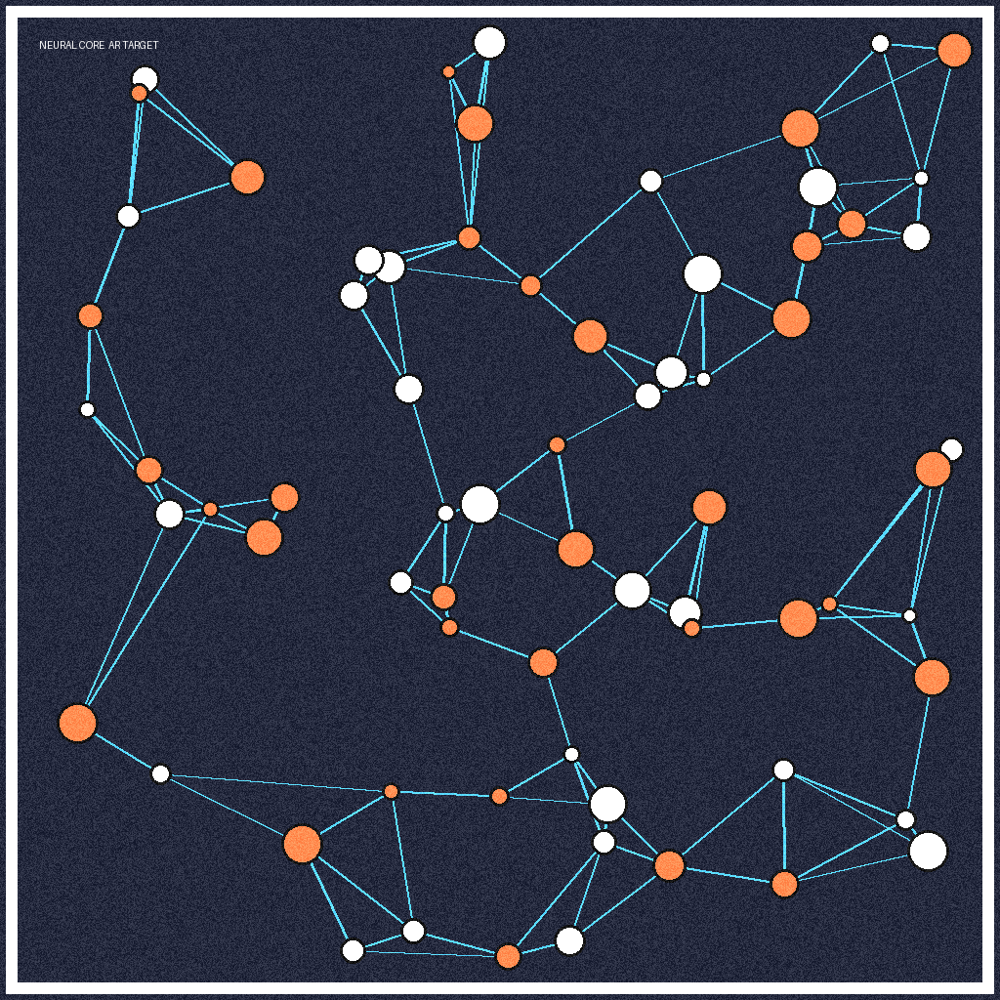

<p align="center">
  
</p>

<h1 align="center">Neural Core AR</h1>

<p align="center">
  <strong>Browser-based markerless augmented reality powered by MindAR + A-Frame</strong>
</p>

<p align="center">
  <a href="https://skilloutofbounds.github.io/neural-core-ar/"></a>&nbsp;
  <a href="https://github.com/skilloutofbounds/neural-core-ar/blob/main/LICENSE"></a>&nbsp;
  &nbsp;
  
</p>

<br />

> Point your phone camera at the target image and watch a procedurally-generated 3D neural core materialize in augmented reality — no app install required.

---

## ✨ Features

- **Zero-install AR** — runs entirely in the browser via WebXR; works on any modern mobile device
- **Image tracking** — uses MindAR's neural-network-based natural feature tracking (no QR/fiducial markers)
- **Procedural 3D model** — generated in Blender with cloud-noise displacement, baked diffuse + normal maps
- **Draco compression** — model optimized from **9.49 MB → 0.31 MB** (96.8% reduction)
- **Smooth animations** — floating hover + continuous rotation via A-Frame's built-in animation system
- **FPS overlay** — append `?stats` to the URL for real-time performance monitoring

---

## 🛠 Tech Stack

| Layer | Technology | Purpose |
| :--- | :--- | :--- |
| **AR Engine** | [MindAR.js](https://hiukim.github.io/mind-ar-js-doc/) v1.2.5 | Markerless image-target tracking |
| **3D Runtime** | [A-Frame](https://aframe.io/) v1.5.0 | Declarative WebXR scene graph |
| **Mesh Compression** | [Google Draco](https://google.github.io/draco/) v1.5.6 | GPU-friendly geometry compression |
| **3D Authoring** | [Blender](https://www.blender.org/) 3.x+ | Procedural modeling, baking, export |
| **Hosting** | GitHub Pages | Static HTTPS hosting |

---

## 📂 Project Structure

```
neural-core-ar/
├── index.html                  # AR scene — entry point for GitHub Pages
├── assets/
│   ├── neural_core.glb         # Optimized 3D model (Draco-compressed, 0.31 MB)
│   ├── targets.mind            # Compiled MindAR image-target descriptor
│   └── target.png              # Source image used for tracking
├── blender/
│   └── make_neural_core.py     # Blender script — procedural generation + bake + export
├── metrics.json                # Optimization metrics (before/after comparison)
├── RESULTS.md                  # Detailed performance report
├── CONTRIBUTING.md             # Contribution guidelines
├── LICENSE                     # MIT License
└── README.md                   # This file
```

---

## 🚀 Quick Start

### Try the Live Demo

1. Open **[the live demo](https://skilloutofbounds.github.io/neural-core-ar/)** on your phone
2. Display the target image below on a second screen (monitor, tablet, or print it out)
3. Point your phone camera at the target — the 3D model will appear and float above it

<details>
<summary><strong>📷 Target Image</strong> (click to expand)</summary>
<br />
<p align="center">
  
</p>
</details>

### Run Locally

```bash
# Clone the repository
git clone https://github.com/skilloutofbounds/neural-core-ar.git
cd neural-core-ar

# Serve over HTTPS (required for camera access)
# Option 1: Python
python -m http.server 8000

# Option 2: Node.js
npx serve .
```

Then open `https://localhost:8000` on your phone (same network) or use a tunnel like [ngrok](https://ngrok.com/).

> **Note:** Camera-based AR requires HTTPS or `localhost`. A plain HTTP connection will not be able to access the camera.

---

## 🔧 Regenerating the 3D Model

If you want to modify or regenerate the neural core model from scratch:

### Prerequisites

- [Blender](https://www.blender.org/download/) 3.0 or later

### Steps

```bash
# Option 1: Run headless from the command line
blender --background --python blender/make_neural_core.py

# Option 2: Open Blender → Scripting tab → paste the script → Run
```

The script will:
1. Generate a high-poly ico-sphere with cloud-noise displacement (~360K triangles)
2. Add a smooth orbital ring
3. Apply procedural materials (noise-driven color ramp + metallic ring)
4. Decimate to **10,000 triangles**
5. UV-unwrap and bake diffuse + normal maps at 1024×1024
6. Export as `neural_core.glb` with Draco mesh compression

Output is saved to `~/neural_core_out/`. Copy `neural_core.glb` into `assets/`.

### Recompiling the Image Target

If you change `assets/target.png`, recompile the MindAR descriptor:

1. Go to the [MindAR Image Target Compiler](https://hiukim.github.io/mind-ar-js-doc/tools/compile)
2. Upload your new `target.png`
3. Download the `.mind` file and save it as `assets/targets.mind`

---

## 📊 Optimization Results

The 3D model was aggressively optimized for mobile AR performance:

| Metric | Before | After | Δ |
| :--- | ---: | ---: | ---: |
| **Triangle count** | 360,448 | 10,000 | **−97.2%** |
| **Draw calls** | 2 | 1 | **−1** |
| **File size** | 9.49 MB | 0.31 MB | **−96.8%** |

Full details with verification logs are available in [`RESULTS.md`](RESULTS.md).

---

## 🏗 Architecture

```
┌─────────────────────────────────────────────────────────┐
│                    Mobile Browser                       │
│                                                         │
│  ┌──────────┐    ┌──────────────┐    ┌───────────────┐  │
│  │  Camera   │───▶│   MindAR.js  │───▶│   A-Frame     │  │
│  │  Feed     │    │  (tracking)  │    │  (rendering)  │  │
│  └──────────┘    └──────┬───────┘    └───────┬───────┘  │
│                         │                    │          │
│              ┌──────────▼────────────────────▼───────┐  │
│              │        WebGL / WebXR Pipeline         │  │
│              │   ┌─────────────┐  ┌──────────────┐   │  │
│              │   │ Draco WASM  │  │  glTF Loader │   │  │
│              │   │  Decoder    │  │              │   │  │
│              │   └─────────────┘  └──────────────┘   │  │
│              └───────────────────────────────────────┘  │
│                                                         │
└─────────────────────────────────────────────────────────┘

        ▲ HTTPS (GitHub Pages)
        │
┌───────┴───────────────────────────┐
│         Static Assets             │
│  index.html · neural_core.glb    │
│  targets.mind                     │
└───────────────────────────────────┘
```

---

## 🤝 Contributing

Contributions are welcome! Please read the [Contributing Guidelines](CONTRIBUTING.md) before submitting a pull request.

---

## 📄 License

This project is licensed under the [MIT License](LICENSE).

---

<p align="center">
  <sub>Built with ❤️ using open-source WebXR technologies</sub>
</p>
